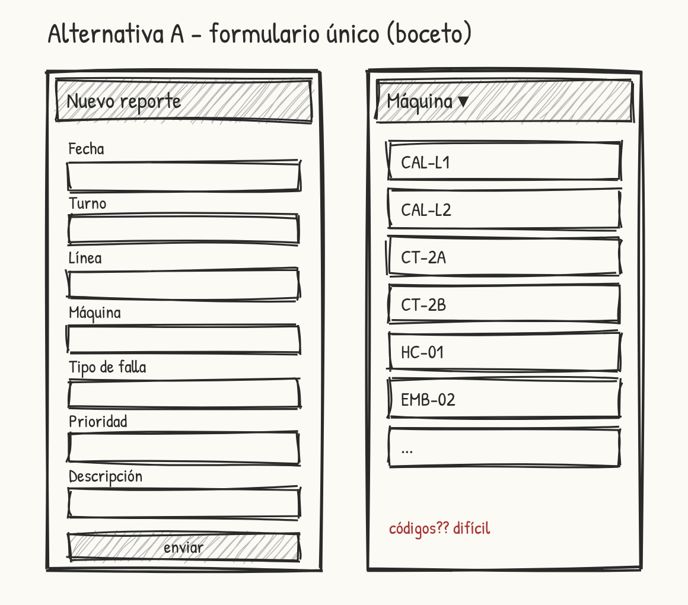
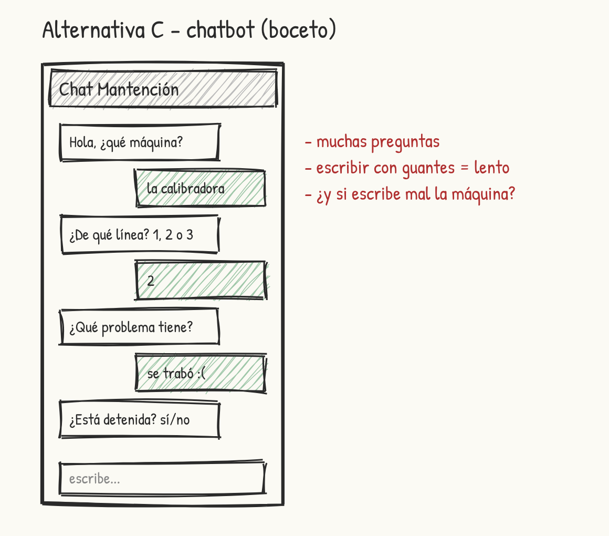

# 2. Diseño de alternativas

Cada integrante hizo bocetos individuales y luego los pusimos en común (similar a las fases de boceto y decisión del *Design Sprint*; Google, s. f.). De ahí salieron tres alternativas:

- **Alternativa A, formulario único:** una pantalla con todos los campos (fecha, turno, línea, máquina, tipo de falla, prioridad y descripción) y un botón "Enviar". Es el enfoque típico de los sistemas de mantención.
- **Alternativa B, asistente paso a paso con QR:** el operario escanea el QR de la máquina y responde tres preguntas cortas con botones grandes. Después de enviar, ve el seguimiento del reporte por estados.
- **Alternativa C, chatbot:** un chat donde un asistente le hace preguntas al operario ("¿Qué máquina?", "¿De qué línea?") y este responde escribiendo.

## 2.1 Tabla comparativa

Comparamos las alternativas según los requisitos del apartado 1.5. Usamos una escala simple: ✔ cumple, ~ cumple parcialmente, ✘ no cumple.

| Criterio (requisito) | A. Formulario único | B. Asistente paso a paso con QR | C. Chatbot |
|---|---|---|---|
| Identificar la máquina sin escribir códigos (R1, R8) | ✘ Lista desplegable con códigos técnicos | ✔ QR y lista por línea como respaldo | ~ El usuario escribe el nombre y puede equivocarse |
| Uso con guantes y sin escribir (R2, R3) | ✘ Campos pequeños y mucho texto | ✔ Botones grandes, solo toques | ✘ Depende de escribir |
| Gravedad siempre informada (R4) | ~ Campo "prioridad" que se puede omitir | ✔ Paso obligatorio con 3 opciones claras | ~ Depende de que el bot lo pregunte |
| Tiempo estimado para reportar | 2 a 3 min | menos de 1 min | 1 a 2 min |
| Carga cognitiva | Alta: todo a la vez | Baja: una decisión por pantalla | Media: hay que recordar qué contestar |
| Confirmación y seguimiento (R6, R7) | ~ Mensaje "enviado" | ✔ N° de reporte y seguimiento por estados | ✔ Confirmación en el mismo chat |
| Funciona con ruido y poca atención (R5) | ~ | ✔ Retroalimentación visual | ~ Hay que leer toda la conversación |
| Costo de desarrollo | Bajo | Medio (QR + app) | Alto si se quiere entender lenguaje natural |

## 2.2 Alternativa seleccionada y justificación

Seleccionamos la **alternativa B: asistente paso a paso con QR**, porque es la que mejor responde a la situación real del operario:

1. **Elimina el problema de identificar la máquina** (R1). Escanear el QR es más rápido y seguro que buscar un código en una lista, y la lista por línea queda como plan B (R8).
2. **Reduce la carga cognitiva**, ya que el operario toma una sola decisión por pantalla y ve en qué paso va (1 de 3, 2 de 3, 3 de 3).
3. **Se puede usar con guantes y apuro** (R2, R3), porque todo se hace con botones grandes con ícono y texto, sin teclado.
4. **Resuelve la incertidumbre del operario** (R6, R7) mostrando el seguimiento del reporte, lo que no tenía el aviso verbal.

Del chatbot rescatamos una idea: los **mensajes con el técnico usando respuestas rápidas** ("Sí, tiene fruta", "No sé"). Así se mantiene la parte conversacional sin obligar a escribir. Del formulario rescatamos la pantalla de **revisión antes de enviar** (R9).
