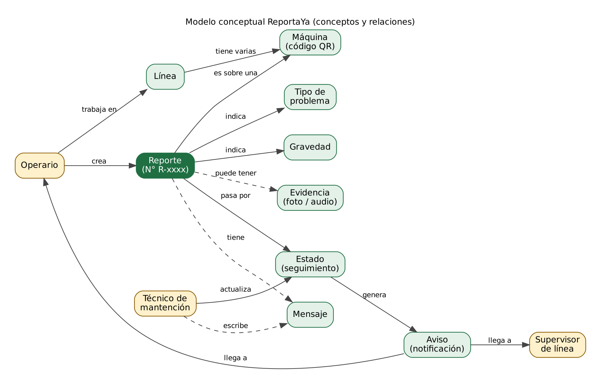

# 3. Modelo conceptual

**¿Qué hará el sistema?** ReportaYa permite que un operario reporte la falla de una máquina en menos de un minuto, que ese reporte llegue al técnico de turno y al supervisor con la información necesaria (máquina, problema y gravedad), y que el operario pueda seguir el estado hasta confirmar que la máquina quedó funcionando.

**¿Cómo se organiza la experiencia?** En dos momentos: (1) **crear el reporte** con un asistente lineal de 3 pasos y (2) **seguir el reporte** mediante una línea de estados con avisos. El usuario no necesita entender cómo funciona el sistema de mantención por dentro; solo debe manejar los conceptos de la tabla siguiente.

| Elemento del modelo conceptual | En ReportaYa |
|---|---|
| Conceptos principales | Máquina, línea, reporte, problema, gravedad, estado, técnico, aviso. |
| Objetos de interacción | Código QR de la máquina, tarjetas de problema con ícono, botones de gravedad con color, resumen del reporte, línea de seguimiento, mensajes con respuestas rápidas. |
| Acciones posibles | Escanear, elegir de una lista, confirmar máquina, elegir problema, elegir gravedad, adjuntar foto o audio, revisar, enviar, ver mis reportes, responder al técnico, confirmar reparación, reabrir. |
| Relaciones entre conceptos | Una línea tiene varias máquinas; un reporte es sobre una máquina y tiene un problema y una gravedad; un reporte pasa por estados (Enviado → Recibido → Técnico en camino → Reparado); el técnico actualiza el estado; cada cambio de estado genera un aviso al operario y al supervisor. |
| Experiencia que se busca apoyar | Reportar rápido, sin miedo a equivocarse, y quedar tranquilo sabiendo que alguien viene en camino. |

**Estados del reporte.** Para el usuario usamos solo cuatro estados con nombres cotidianos, aunque internamente el sistema de mantención pueda tener más (asignado, en diagnóstico, esperando repuesto, etc.):

| Estado que ve el operario | Qué significa |
|---|---|
| Enviado | El reporte salió del celular. |
| Recibido por mantención | Un técnico lo vio y lo tomó. |
| Técnico en camino | El técnico va hacia la máquina (se muestra el tiempo estimado). |
| Reparado | El técnico terminó. El operario confirma si funciona bien o lo reabre. |
