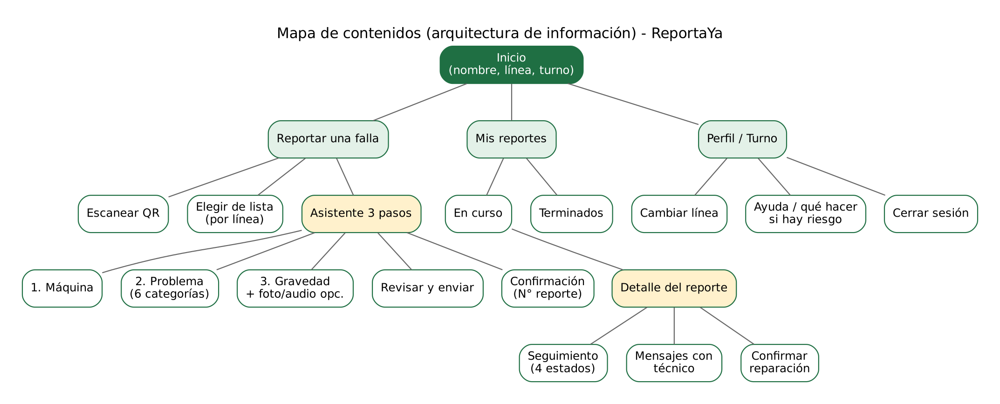
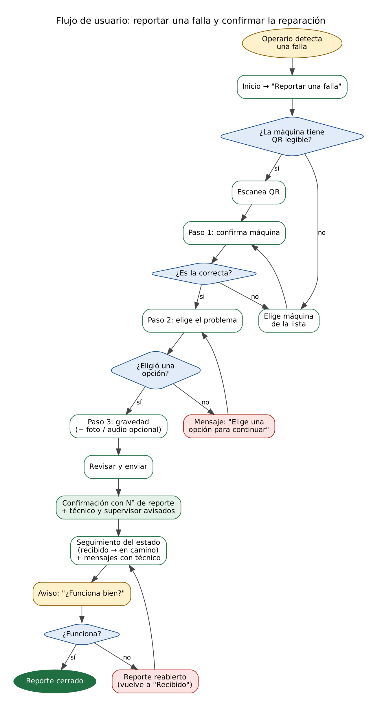

# 6. Arquitectura de información y flujo de usuario

## 6.1 Organización de contenidos

La arquitectura de información busca que el contenido sea fácil de encontrar y de comprender (Rosenfeld et al., 2015). Para ReportaYa revisamos sus componentes principales según Gabriel-Petit (2025). La aplicación tiene **tres secciones** a las que se llega desde el inicio. Para mantenerla simple, dejamos la acción principal (reportar) como un botón grande y no en un menú.

| Componente de AI | Decisión en ReportaYa |
|---|---|
| Sistema de organización | Por **tarea** (reportar / ver mis reportes) y, dentro de la lista de máquinas, por **línea**, porque así se ubican físicamente los operarios. Los reportes se ordenan por estado: "En curso" primero y "Terminados" después. |
| Sistema de etiquetado | Palabras cotidianas de la planta, no términos técnicos: "Reportar una falla" (no "Crear orden de trabajo"), "¿Qué le pasa?" (no "Tipo de falla"), "Línea detenida" (no "Prioridad crítica"). Cada categoría lleva ícono y texto. |
| Sistema de navegación | Navegación lineal en el asistente, con barra de 3 pasos, botón "← Volver" siempre arriba a la izquierda y acción principal siempre abajo. Desde la confirmación se puede volver al inicio o ver el reporte. |
| Sistema de búsqueda | No se necesita búsqueda por texto. El QR cumple ese rol y, como respaldo, hay una lista filtrada por la línea del usuario. |
| Taxonomía | Línea → Máquina. Problemas en 6 categorías (no enciende, ruido extraño, se atasca/trabada, fuga, pieza suelta o rota, otro). Gravedad en 3 niveles. |
| Metadatos | Cada reporte guarda automáticamente: máquina, línea, operario, turno, hora, problema, gravedad, técnico asignado y hora de cada cambio de estado. El operario no ingresa ninguno de estos datos a mano. |

## 6.2 Etiquetas principales

| Pantalla | Título / etiqueta | Botón principal |
|---|---|---|
| Inicio | ReportaYa · Línea 2 · Turno A | Reportar una falla |
| Escanear | Escanear máquina | (lectura automática) · "No encuentro el código" |
| Paso 1 | ¿Es esta la máquina? | Sí, es esta / No, elegir otra |
| Paso 2 | ¿Qué le pasa? | Continuar |
| Paso 3 | ¿Cómo está la línea? | Revisar reporte |
| Revisar | Revisa antes de enviar | Enviar reporte |
| Confirmación | ¡Listo, reporte enviado! | Volver al inicio |
| Detalle | Reporte R-0142 | Respuestas rápidas al técnico |
| Confirmar reparación | ¿La calibradora funciona bien? | Sí, funciona bien / No, sigue fallando |

## 6.3 Flujo de usuario

El flujo de usuario representa la secuencia de pasos que una persona sigue para completar una tarea (Stimac, 2023). Nuestro flujo principal recorre la estructura anterior para completar la tarea. Incluye los caminos alternativos (QR no legible, máquina equivocada), el manejo de error (avanzar sin elegir) y el cierre del ciclo (confirmar o reabrir).

En el camino feliz, el operario completa el reporte con **5 toques**: Reportar → (QR) → Sí, es esta → problema → gravedad → Enviar. Con la lista de máquinas como respaldo, son 6 toques.
