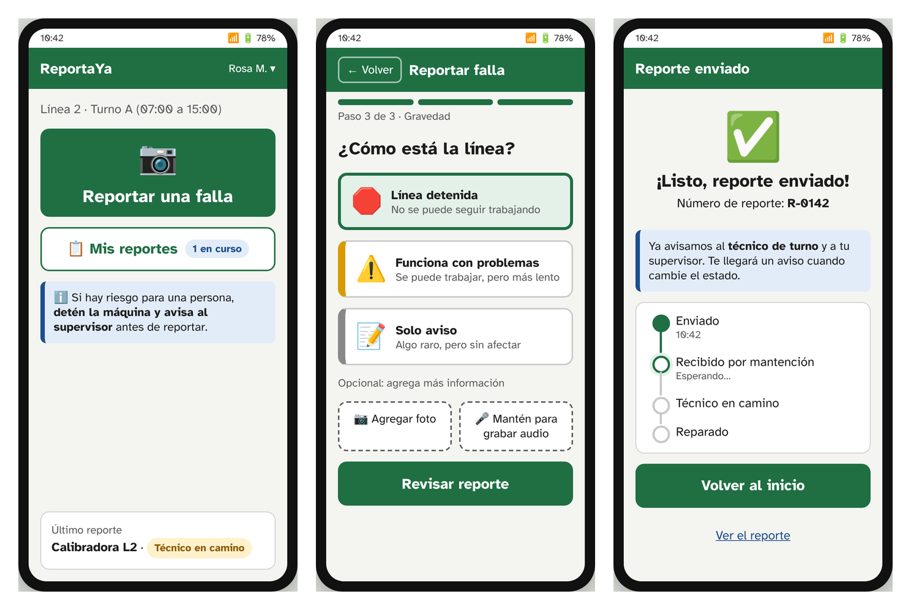

# 7. Diseño visual y emocional

## 7.1 Decisiones visuales

Según Tidwell et al. (2020), el diseño visual no busca solo que la interfaz se vea bonita, sino apoyar la comprensión, la usabilidad y la confianza. Por eso cada decisión de la tabla se relaciona con un requisito del apartado 1.5.

| Aspecto | Decisión en ReportaYa | Justificación |
|---|---|---|
| Jerarquía visual | En el inicio, "Reportar una falla" es el elemento más grande (120 px de alto, con ícono de cámara). Hay una sola acción principal por pantalla, en verde y abajo. | El operario debe encontrar qué hacer en menos de un segundo, incluso de reojo. |
| Claridad | Una pregunta por pantalla, escrita como la diría una persona ("¿Qué le pasa?"). | Reduce la carga cognitiva y evita la ambigüedad. |
| Accionabilidad y *affordance* | Botones con fondo sólido o borde grueso; las tarjetas seleccionadas se marcan con borde verde de 4 px y fondo verde claro. | Lo que es interactivo debe parecer presionable, y lo elegido debe notarse. |
| Tamaño de los objetivos táctiles | Botones de 60 px de alto mínimo y tarjetas de 104 px. | Uso con guantes y en movimiento (R2). |
| Color | Verde para avanzar y para lo "OK"; rojo, amarillo y gris para la gravedad. **El color siempre va acompañado de ícono y texto** (🛑 "Línea detenida"). | Accesibilidad para daltonismo y pantallas con brillo bajo (R11). |
| Tipografía y legibilidad | Atkinson Hyperlegible, diseñada por el Braille Institute para lectores con baja visión, con texto base de 17 px y títulos de 24 px. Sin cursivas ni textos en mayúsculas largos. | Legibilidad con luz artificial, pantallas sucias y usuarios con distinta agudeza visual. |
| Consistencia y alineación | "← Volver" siempre arriba a la izquierda, botón principal siempre abajo y mismo estilo de tarjetas en todo el flujo. | Lo predecible se aprende después del primer uso. |
| Íconos | Emoji/íconos reconocibles junto a la etiqueta (🔌 No enciende, 💧 Fuga), nunca íconos solos. | Apoyan la lectura rápida sin reemplazar al texto. |
| Retroalimentación | Barra de avance de 3 pasos, mensaje de error en rojo claro ("Elige una opción para continuar"), pantalla de éxito con ✅ y número de reporte, y línea de estados. | El usuario siempre sabe dónde está, qué hizo y qué viene (R6, R7). |

## 7.2 Decisiones emocionales

Las emociones influyen en la atención, la memoria y la toma de decisiones; una experiencia frustrante concentra la atención en el problema y afecta la percepción de todo el sistema (Van Gorp & Adams, 2012). El operario reporta en un momento de **estrés**: la línea se detuvo, el supervisor está presionando y a veces teme que lo culpen. Por eso el diseño emocional busca transmitir **tranquilidad, confianza y sensación de control**.

| Nivel (Rogers et al., 2023) | Decisión | Emoción que buscamos |
|---|---|---|
| **Visceral** (primera impresión) | Interfaz limpia, con mucho espacio, colores sobrios (verde oscuro y fondo claro) y sin publicidad ni menús escondidos. | "Esto es simple, lo puedo hacer". |
| **Conductual** (uso) | Una decisión por pantalla, posibilidad de volver atrás y pantalla de revisión antes de enviar; los errores se explican sin culpar ("Elige una opción para continuar" en vez de "Error: campo obligatorio"). | Control y seguridad de no equivocarse. |
| **Reflexivo** (significado) | El mensaje final es "¡Gracias, Rosa!" con el tiempo total de la reparación; se usa el nombre de la persona y su aviso se reconoce como un aporte. | Sentir que avisar es valorado y no un problema. |

Otras decisiones para generar **confianza**:

- Mostrar que el aviso llegó a una persona real: "Ya avisamos al **técnico de turno** y a tu supervisor" y, luego, el nombre del técnico (Juan P.).
- El tiempo estimado ("Llegada estimada: 5 min") disminuye la ansiedad de la espera, igual que en el delivery.
- El operario cierra el ciclo confirmando si quedó bien, lo que le da **sensación de control** sobre el resultado.

