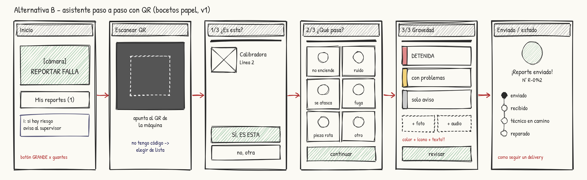
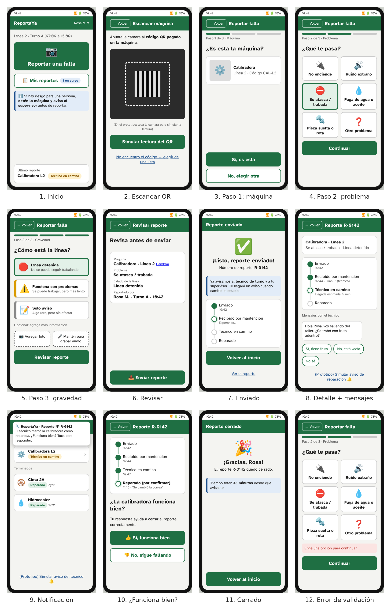

# 8. Prototipado

Trabajamos en dos niveles de fidelidad, como propone el curso (Rogers et al., 2023):

## 8.1 Prototipo de baja fidelidad (bocetos)

Primero dibujamos bocetos de las tres alternativas para compararlas (apartado 2). Después, para la alternativa B, hicimos el recorrido completo en 6 pantallas. En los bocetos anotamos en rojo las decisiones que salieron de los requisitos (botón grande por los guantes, color + ícono + texto, seguimiento tipo delivery).

## 8.2 Prototipo navegable de media fidelidad

Con los bocetos acordados construimos un **prototipo navegable en HTML/CSS/JavaScript** que simula la app en un celular. Lo consideramos de **media fidelidad** porque tiene la estructura, los textos, la navegación, la validación de errores y los estados reales del flujo, pero usa datos de ejemplo, no tiene backend y la cámara se simula.

- **Ver prototipo:** https://matcontardo.github.io/ihc-u2-reportaya/prototipo/media-fidelidad/
- **Código:** carpeta `prototipo/media-fidelidad/` del repositorio.

El prototipo incluye 13 pantallas. Las principales son:

| N° | Pantalla | Qué permite probar |
|---|---|---|
| 1 | Inicio | Encontrar la acción principal y el aviso de seguridad. |
| 2 | Escanear máquina | Simular la lectura del QR o pasar a la lista. |
| 3 | Elegir máquina | Explorar las máquinas de la línea (plan B). |
| 4 | Paso 1: ¿Es esta la máquina? | Confirmar o corregir la máquina. |
| 5 | Paso 2: ¿Qué le pasa? | Elegir el problema; si no elige, aparece un mensaje de error. |
| 6 | Paso 3: ¿Cómo está la línea? | Elegir la gravedad y agregar foto o audio (mantener presionado). |
| 7 | Revisar | Ver el resumen y corregir antes de enviar. |
| 8 | Reporte enviado | Confirmación con N° y seguimiento. |
| 9 | Mis reportes | Ver reportes en curso y terminados. |
| 10 | Detalle + mensajes | Seguimiento y respuestas rápidas al técnico. |
| 11 | Notificación | El sistema avisa que la máquina fue reparada. |
| 12 | ¿Funciona bien? | Confirmar o reabrir el reporte. |
| 13 | Reporte cerrado / reabierto | Cierre del ciclo. |

Las capturas individuales están en la carpeta `prototipo/media-fidelidad/capturas/`.

## 8.3 Limitaciones y próximos pasos

- El prototipo **todavía no ha sido evaluado con usuarios reales**. Como siguiente iteración proponemos pedirle a 3 a 5 operarios que realicen la tarea "La calibradora de tu línea se trabó y la línea está detenida. Repórtalo." y observar la eficacia (si lo logran), la eficiencia (tiempo y toques), la comprensión (dudas en cada pantalla) y la satisfacción.
- Falta validar con la planta si se usará el celular personal, uno de la empresa o una tablet por línea, lo que puede cambiar el inicio de sesión.
- La pantalla de perfil (cambiar línea, ayuda, cerrar sesión) aparece en el mapa de contenidos pero no fue prototipada, porque no forma parte de la tarea principal.
- Una versión de alta fidelidad debería probar el contraste en una pantalla real dentro de la planta y el tamaño de los botones con guantes.
